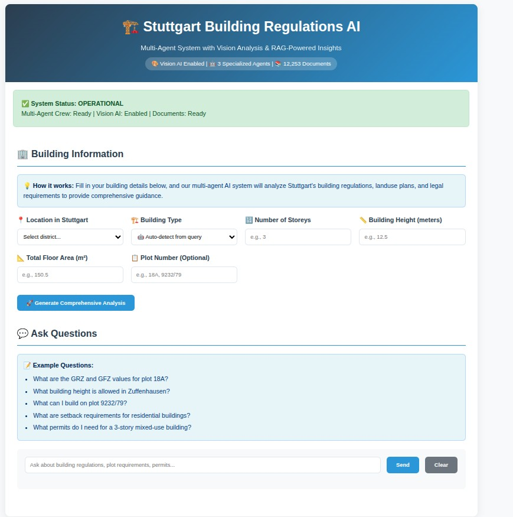
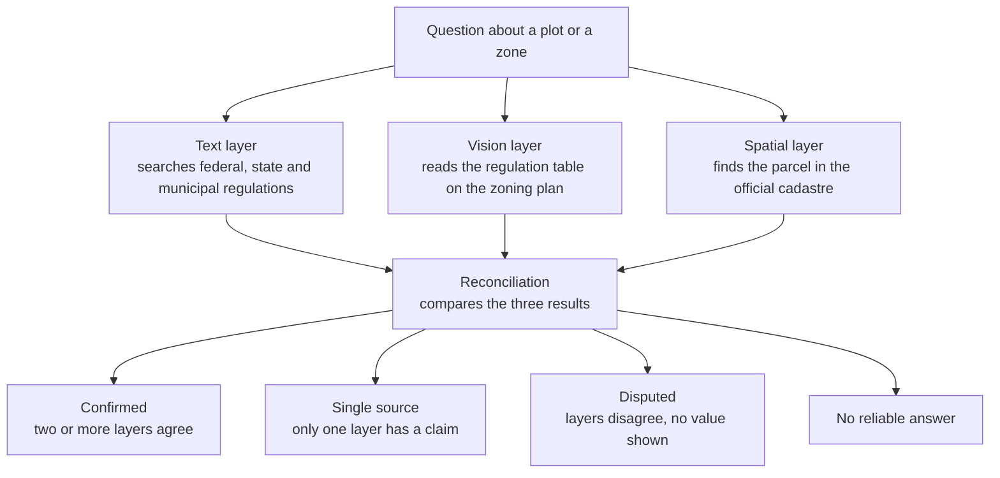
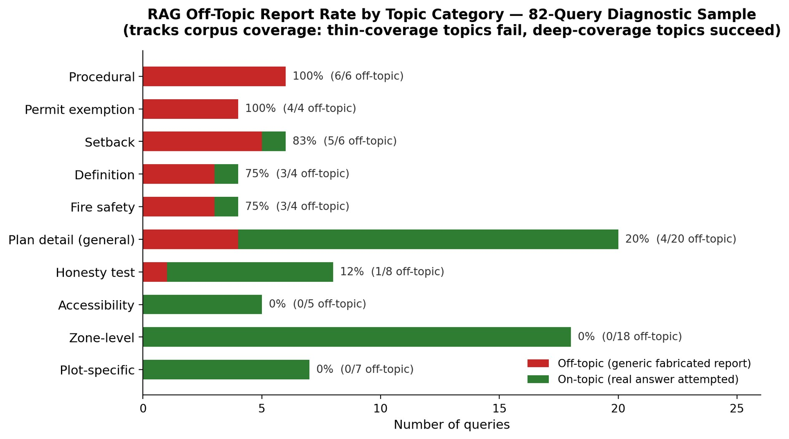
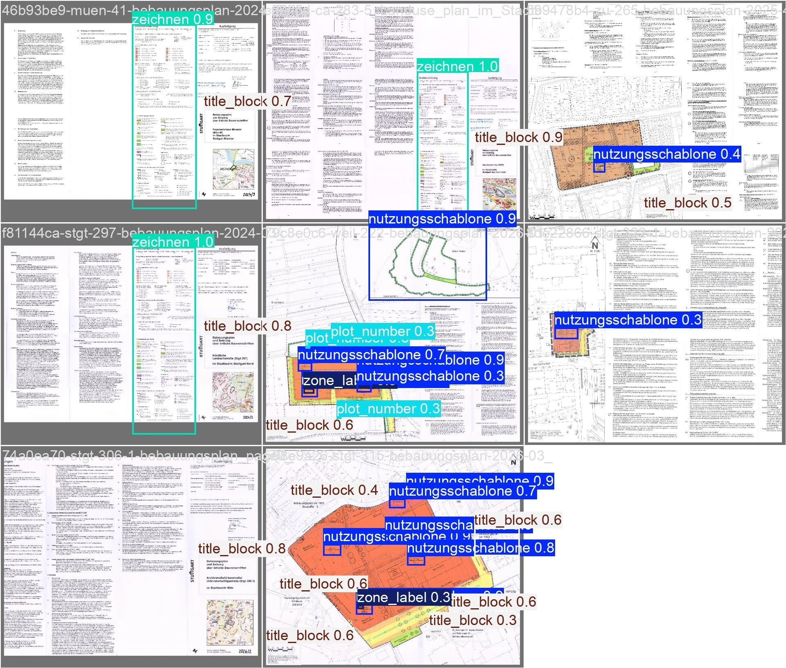
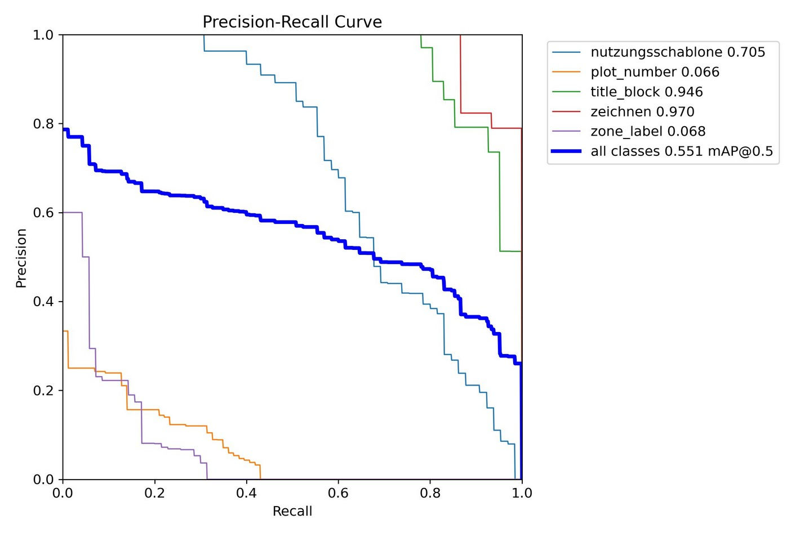
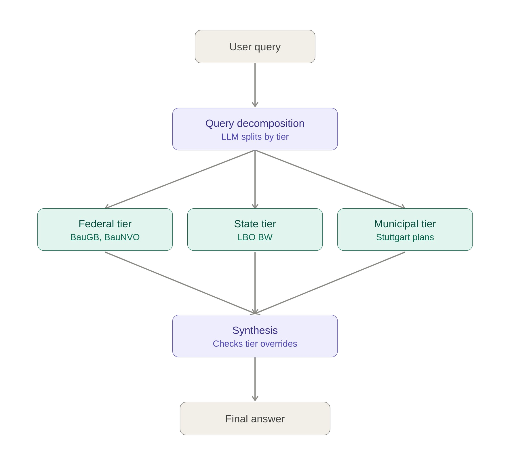

# AI for Digital Building Permitting in Stuttgart

An AI system that answers building regulation questions for Stuttgart from three independent sources, and an evaluation of how often and how honestly each source is right.

This is the system behind my M.Sc. thesis (HfWU Nürtingen-Geislingen, 2026). The source code is private. This page describes what the system does, how I tested it and where it fails.

*Interface of the deployed text layer. The screenshot was taken before the federal statutes were added to the corpus, so it still shows 12,253 text chunks.*

## The problem

A question such as "what may I build on this plot?" has no single place to be answered in Stuttgart.

- **Three levels of law:** federal (BauGB, BauNVO), state (LBO Baden-Württemberg) and municipal (development plans and local statutes).
- **Three offices:** the city planning office holds the development plans, the building law office handles permits, and the surveying office holds the geodata.

From expert consultation, a query that involves more than one office takes between 11 and 21 working days. The building law office alone receives about 2,340 queries per month.

Before designing anything, I modelled this process as a five-lane BPMN diagram, built from correspondence with the offices and checked in an interview with a professor of planning law.

## The system

One question, three sources that do not depend on each other.

In the current version the three layers run separately and a reconciliation module compares their outputs afterwards. A single controller that routes one question to all three is the next development step.

| Layer | What it does | Built with |
|---|---|---|
| **Text** | Retrieval over 12,701 chunks of regulation text (6,444 federal, 1,193 state, 1,637 municipal, 3,427 untagged). Two agents, a document specialist and an architecture consultant, write a cited answer in under 90 seconds. | CrewAI, OpenAI API, FastAPI, Docker, Railway. Embeddings are compared directly in NumPy, without a vector database. |
| **Vision** | Finds the regulation table (Nutzungsschablone) on a development plan and reads the site coverage ratio (GRZ), floor area ratio (GFZ), building height, roof rule and zone type. Each value carries a confidence tag. Runs locally on a laptop CPU in under two seconds per query. | YOLOv8n trained on 34 plan pages that I annotated in five classes, EasyOCR, Label Studio, Google Colab |
| **Spatial** | Resolves a plot number or an address to its parcel and computes how much of the parcel is built on. | ALKIS open data (39,469 parcels and 166,286 building footprints), GeoPandas, QGIS, Nominatim |

## How I evaluated it

Three strands, following Design Science Research, so that no single result has to carry the argument.

### 1. Users

An earlier, text-only version was rated by 55 participants in a study run by a student research team at HfWU. Participants who used the system live rated it better than those who only watched a video (mean grade 2.46 against 2.98, where lower is better). Ratings were driven mainly by whether the system had answered the question well, not by how polished it looked.

This strand says that the approach was useful to people. It does not say that the answers were correct. That is what the benchmark is for.

### 2. Experts

Three independent sources described the current process: a professor of planning law, the building law office and the city planning office. They agreed on the core problem, that responsibility is split across offices. They disagreed on one point, whether cross-office questions are escalated to the political level. I kept that disagreement as a finding instead of smoothing it over. One correction from the interview changed my process model.

### 3. Technical benchmark

25 queries with answers that I verified by hand against the plans and the legal text. 19 of them can be compared across all three layers.

| Layer | Correct | Partly correct | Confidently wrong | Declined or not attempted |
|---|---|---|---|---|
| Text | 5 | 0 | 0 | 14 |
| Vision | 5 | 0 | 0 | 14 |
| Spatial | 0 | 1 | 6 | 12 |

The pattern behind the numbers:

- On the 5 **zone-level** questions, the text and vision layers were right every time.
- On the 14 **plot-level** questions, neither of them gave an answer. They were never wrong, but never right either.
- The spatial layer attempted most of the first ten questions and was wrong more often than right, for one systematic reason described below. On the nine questions added later it failed earlier, at reading the plot number from the question.

## Where it fails

### Text layer

| Problem | Cause | Status |
|---|---|---|
| The same invented values (GRZ 0.5, GFZ 1.8) appeared for different plots | A worked example in an agent prompt was reproduced whenever retrieval failed | Corrected and tested before and after. A separate checking tool later reproduced the defect on the deployed system from outside, on two plots |
| Estimates given although the prompt forbade estimating | A second instruction in the same prompt told the agent to fall back on "standard assumptions" | Corrected |
| Federal rules were not found or were cited wrongly | The federal statutes were missing from the corpus as full text | Corrected by adding them (448 chunks) |
| A place name in the question pulled up text about the place instead of the relevant statute | Retrieval ranking | Solved in a separate module that splits the question by level of government. Tested on four queries, not yet in the deployed path |
| Plot-specific questions are treated as general definition questions | The query classifier never recognises them | Open |
| A generic, unrelated report is returned instead of an answer | Not yet identified | Open |

The last one is the most serious. In a wider sample of 82 questions it happened on 26 (32%). It follows corpus coverage closely: topics with deep coverage were always answered on topic, topics with thin coverage almost never.

### Vision layer

General-purpose vision-language models could not read these plans reliably, which is why I trained a dedicated detector.

| Class | mAP50 |
|---|---|
| Legend | 0.970 |
| Title block | 0.946 |
| Regulation table (Nutzungsschablone) | 0.705 |
| Zone label | 0.068 |
| Plot number | 0.066 |
| All classes | 0.551 |

The detector finds the regulation table on most plans. It does not find plot numbers, which are small, inconsistently styled and scattered across the drawing. That is why plot-level questions are declined: the system cannot link a value to a plot it cannot locate, and it refuses instead of guessing. On a plan from outside its training set it produced a low-confidence reading. After that case I added confidence tags to every extracted value.

### Spatial layer

| Problem | Cause | Status |
|---|---|---|
| A street address resolves to the road, not to the building plot | Geocoding returns a point on the street centreline, and that point lies in the road parcel | Reduced by looking up plot numbers directly when the question contains one |
| The wrong parcel is chosen silently | Parcel numbers are unique only within a cadastral district, not across the city | Fixed. The system now lists the candidates and declines |
| Built coverage above 100% | Buildings near the point were summed, not only those on the parcel | Fixed. Impossible values are rejected |
| A plot number on a plan has no match in the cadastre | Plans keep the parcel boundaries from the day they were adopted. The cadastre changes with every sale and subdivision | Open. No automatic safeguard found |
| The plot number in the question is not recognised | The parser looks for the wording "plot X" but not "Flurstück X" | Open |

## The central finding

**No single layer is reliable enough to use on its own, and they fail in different ways.**

In one case all three layers were asked about the same plot and returned three different results: a confident wrong number from the text layer, a low-confidence reading from the vision layer that was not flagged, and a hedge from the spatial layer. Any one of them alone would have looked believable. Side by side, the disagreement is visible.

Combining layers also produces answers that none of them has alone. For one plot, the plan allows a site coverage of 0.6. The cadastre shows 644.8 m² of building on a 2,287 m² parcel, which is 0.28. Together they say how much room is left to build.

## Limits

- One city. The corpus, the plans and the cadastre data are all from Stuttgart.
- The vision model was trained on 34 annotated pages.
- The benchmark is small: 25 scored queries and an 82-query diagnostic sample.
- The user study covers the earlier text-only version, not the vision and spatial layers.
- This is a support tool that needs a professional to check its answers. It is not an authority.

## Query decomposition by level of government

The fix for the retrieval ranking problem: the question is split into up to three sub-questions, one each for federal, state and municipal law. Each is searched only in its own part of the corpus, and the final step checks whether a state or municipal rule overrides the federal default.

## Thesis and talks

- **M.Sc. thesis:** "AI-Assisted Regulatory Intelligence for Built Environment Professionals: Restoring Information Mobility in Stuttgart's Multi-Level Building Governance", HfWU Nürtingen-Geislingen, August 2026. Supervisors: Prof. Dr. Burkhard Hoppenstedt and Prof. Dr.-Ing. Kirsten David.
- **DBP26, Munich, November 2026:** poster, "Restoring Information Mobility in Multi-Level Building Governance: A Deployed Multi-Agent RAG System for German Building Regulations"
- **OGC iDays 2026, Munich, November 2026:** accepted presentation
- A journal paper on the evaluation is in preparation.

## Access

The source code, the prompts and the benchmark query set are private. I am happy to give a walkthrough or a live demo on request: [LinkedIn](https://www.linkedin.com/in/meetrehmann).

## Data credits

Cadastre data: ALKIS, LGL Baden-Württemberg, www.lgl-bw.de, Data licence Germany, attribution, version 2.0. Development plans: Landeshauptstadt Stuttgart. The usability survey was conducted by a student research team at HfWU.

Author: Abdul Rehman, [github.com/meet-rehman](https://github.com/meet-rehman)
